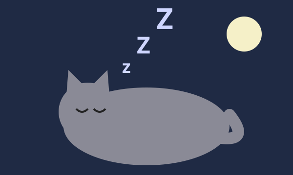
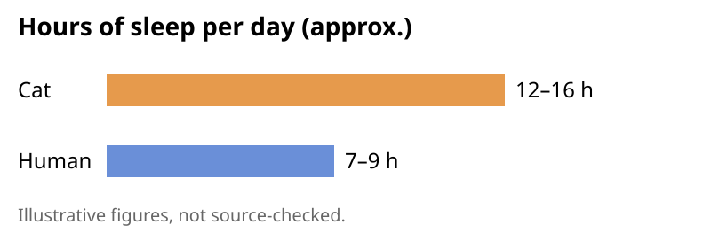

# More Cats

Cats sleep around 12 to 16 hours a day, which is why they always seem rested and slightly smug.

## Quick facts

- **Purring** is thought to happen at 25–150 Hz, a range some studies link to comfort and healing.
- **Whiskers** sense small changes in air and space, which helps cats judge gaps in the dark.
- **Righting reflex**: cats twist in midair to land on their feet, usually.
- **Slow blinks** from a cat are often read as a sign of trust. Try blinking slowly back.

## A small cat philosophy

A cat does what it wants, when it wants, and still expects dinner on time.

## Pictures

